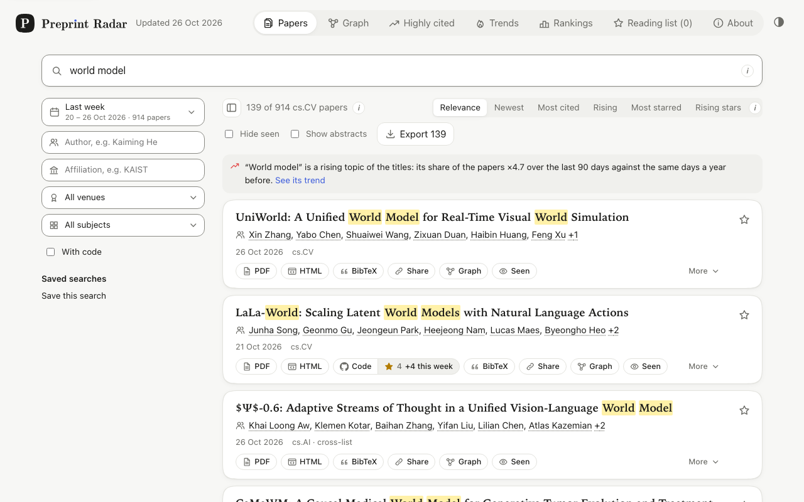
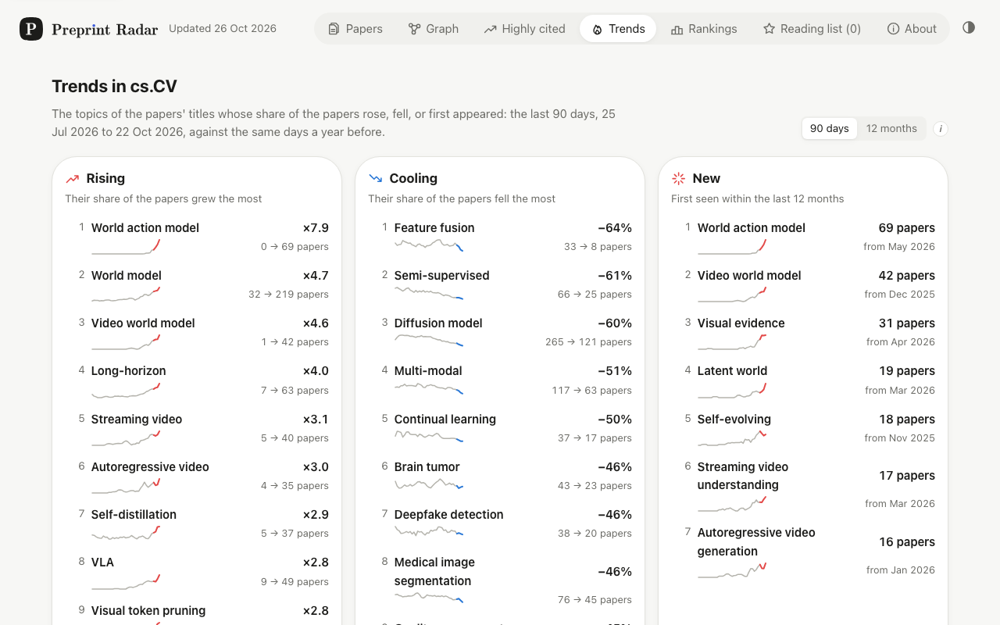
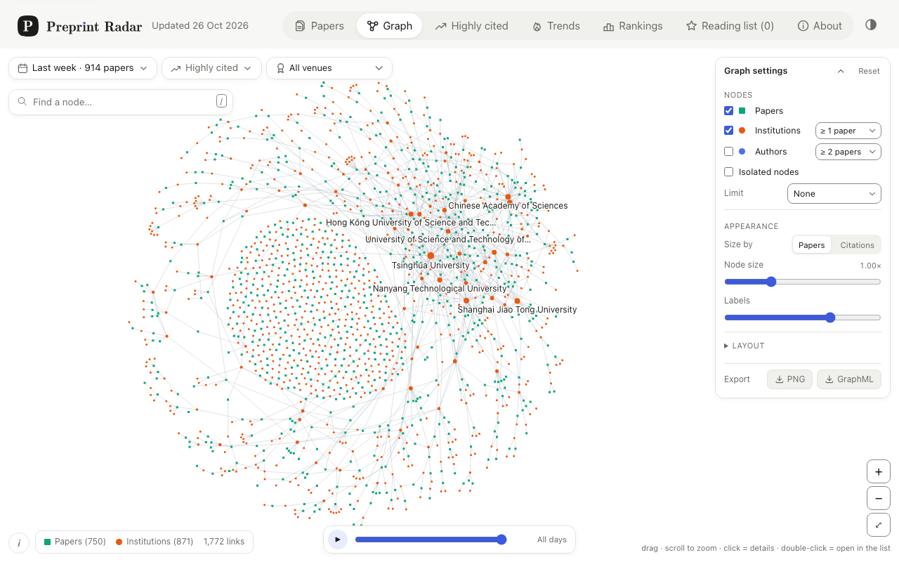
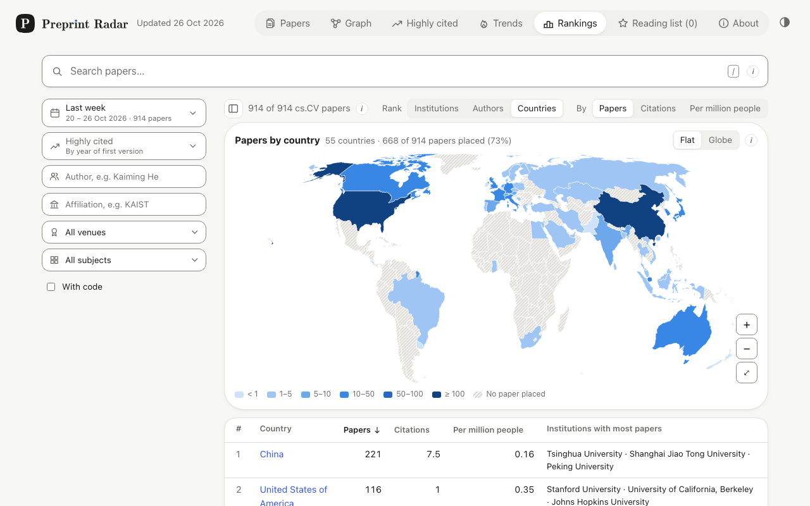

<p align="center">
  <picture>
    <source media="(prefers-color-scheme: dark)" srcset="web/public/preprint-radar-lockup-dark.svg">
    
  </picture>
</p>

<p align="center">
  <b>Follow and search the computer vision papers announced on arXiv every weekday,</b><br>
  with their authors' affiliations, their citations, their code and the topics on the rise.
</p>

<p align="center">
  <a href="https://titouanlegourrierec.github.io/preprint-radar/"><b>Open Preprint Radar →</b></a>
</p>

<p align="center">
  <a href="https://github.com/titouanlegourrierec/preprint-radar/actions/workflows/update.yml"></a>
  <a href="https://github.com/titouanlegourrierec/preprint-radar/actions/workflows/ci.yml"></a>
  <a href="https://github.com/titouanlegourrierec/preprint-radar/releases"></a>
  <a href="LICENSE"></a>
</p>



Preprint Radar collects the papers of arXiv's cs.CV category the day they are announced,
reads who wrote them where, follows their citations, and keeps the most cited papers since
2010. A static site searches all of it in your browser: no account, no cookie, no
server, and what you save stays on your device.

## Features

- **Search as you type** over titles, abstracts, authors, affiliations and venues, with
  prefixes, typos, `"phrases"` and `-exclusions`; filter by author, institution, venue,
  subject or code. Every search is a link to share.
- **Highly cited**: the most cited papers of each year since 2010 and of the last 12
  months, by citations or by those gained this week.
- **Trends**: the topics of the titles that rise, cool or are new, with their impact and
  key papers, and an explorer that draws any topic since 2010.
- **Rankings**: the institutions, authors and countries of the papers shown, on a world map
  or a globe.
- **Graph**: papers, institutions and authors, or who works with whom, replayed day by day.
- **Reading list**: papers you star, in folders, exported to BibTeX, RIS, CSV or Markdown;
  it stays in your browser.
- **Feeds**: an Atom feed for every institution and major venue.

<table>
  <tr>
    <td width="33%"></td>
    <td width="33%"></td>
    <td width="33%"></td>
  </tr>
  <tr>
    <td align="center">Trends</td>
    <td align="center">Graph</td>
    <td align="center">Rankings</td>
  </tr>
</table>

## How it works

A Python pipeline, run by GitHub Actions every weekday, reads arXiv's listing, each paper's
abstract and the front matter of its HTML rendering for the affiliations, and asks the
[Research Organization Registry](https://ror.org), [OpenAlex](https://openalex.org) and
[Semantic Scholar](https://www.semanticscholar.org) for institutions and citations. Every
Sunday it ranks the whole category since 2010 by citations and counts the topics of the
titles. It commits the results to [`data/`](data), which GitHub Pages serves with the
Preact app. [How it works](docs/architecture.md) has the details.

The data is open: every file is served next to the site
([`data/index.json`](https://titouanlegourrierec.github.io/preprint-radar/data/index.json))
and [documented](docs/data-format.md), field by field.

## Run it yourself

```bash
git clone --filter=blob:none https://github.com/titouanlegourrierec/preprint-radar.git
cd preprint-radar
make install   # needs uv and Node.js 24+
make dev       # the site on http://localhost:5173
```

[Development](docs/development.md) covers the pipeline's commands and the tests, and
[Deploying your own copy](docs/deployment.md) sets up the workflows for other categories.

## Documentation

All of it is in [`docs/`](docs/README.md): how the data is collected and stored, how the
site works, the runbook and the roadmap.

## Contributing

Bug reports, data corrections and ideas are welcome as
[issues](https://github.com/titouanlegourrierec/preprint-radar/issues/new/choose);
[contributing.md](docs/contributing.md) explains how to propose a change. Report a
vulnerability privately ([SECURITY.md](SECURITY.md)).

## License

The code is under the [MIT license](LICENSE). The data keeps the terms of its sources:
arXiv's metadata, ROR's and OpenAlex's records are CC0; citation counts come from the
Semantic Scholar API under its license agreement ([details](docs/data-format.md#licenses)).

Thank you to arXiv for use of its open access interoperability. This project is not
affiliated with arXiv.
